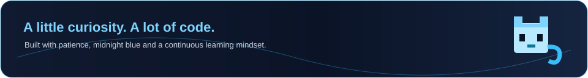

  

# Eduardo Mafezoli

**Desenvolvedor Full Stack**

Desenvolvedor Full Stack com foco em **Node.js, Python, Vue.js e React**. Gosto de transformar ideias em aplicações funcionais, unindo desenvolvimento backend e frontend.

  
  
  

## Sobre mim

Sou Eduardo Mafezoli, desenvolvedor Full Stack. Meu foco é construir aplicações web, trabalhando tanto na lógica e estrutura do backend quanto na experiência e interface do frontend.

## Tecnologias

### Backend

  
  

### Frontend

  
  
  
  
  
  

### Banco de dados

  
  
  

### Ferramentas

  
  
  
  

## Contato

  
  
  

  

