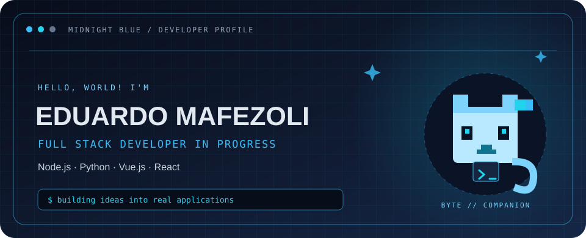

<p align="center">
  
</p>

# Eduardo Mafezoli

**Desenvolvedor Full Stack em formação · UNIFOR · CJCA**

Construindo aplicações web do backend ao frontend, com foco em **Node.js, Python, Vue.js e React**.

Gosto de entender como as aplicações funcionam por inteiro: projetar APIs, trabalhar com dados, criar interfaces e pensar em segurança desde o início. Minha trajetória em cibersegurança complementa meu interesse por desenvolvimento de software e resolução de problemas.

<p>
  <a href="#projetos"></a>
  <a href="#tecnologias"></a>
  <a href="#em-desenvolvimento"></a>
  <a href="#ciberseguranca"></a>
  <a href="#contato"></a>
</p>

## Projetos

### 01 / Repositórios públicos

Estou estruturando meu portfólio de desenvolvimento. Por enquanto, acompanhe os códigos, estudos e próximos projetos diretamente nos meus repositórios.

<p>
  <a href="https://github.com/Edmafezoli?tab=repositories"></a>
</p>

**Em breve:** projetos full stack que demonstrem integração entre APIs, banco de dados e interfaces web. Os projetos serão adicionados aqui conforme estiverem publicados e documentados.

## Tecnologias e ferramentas

### Desenvolvimento

<p>
  
  
  
  
  
  
  
  
</p>

Meu foco de desenvolvimento está em Node.js e Python no backend, com Vue.js e React no frontend. JavaScript, TypeScript, HTML e CSS complementam essa trilha.

### Banco de dados e infraestrutura

<p>
  
  
  
  
  
</p>

### Cibersegurança

<p>
  
  
  
</p>

**Defensive Security · Python Security Automation · Linux & System Hardening · Network Security · Vulnerability Assessment · Security Operations**

## Em desenvolvimento

```text
eduardo@midnight-blue:~$ learning --current

[BACKEND]   Node.js  | Python
[FRONTEND]  Vue.js   | React
[WEB]       JavaScript | TypeScript | HTML | CSS
[GOAL]      Full Stack Development

STATUS: learning, building and improving.
```

Estou aprofundando meus conhecimentos para desenvolver aplicações completas, conectando backend, frontend, persistência de dados e boas práticas de segurança.

## Cibersegurança

Minha formação em segurança da informação continua fazendo parte da minha base técnica.

- **Certificação:** HTB Certified Junior Cybersecurity Associate (CJCA).
- **Interesses:** segurança defensiva, análise de vulnerabilidades, redes e operações de segurança.
- **Prática:** laboratórios de segurança, análise de evidências e automação com Python.

Quero levar essa mentalidade para o desenvolvimento: escrever software funcional, mas também considerar validação, exposição de dados e segurança das aplicações.

## Formação

- **UNIFOR** — formação acadêmica em andamento.
- **Inglês** — fluente.
- **CJCA** — HTB Certified Junior Cybersecurity Associate.

## Atividade pública

Acompanhe meu histórico de contribuições e os repositórios públicos para ver minha evolução, estudos e projetos.

<p>
  <a href="https://github.com/Edmafezoli?tab=repositories"></a>
  <a href="https://github.com/Edmafezoli"></a>
</p>

## Vamos conversar?

Tenho interesse em desenvolvimento de software, aplicações web, backend, frontend e segurança de aplicações.

<p>
  <a href="https://github.com/Edmafezoli"></a>
</p>

<p align="center">
  
</p>
